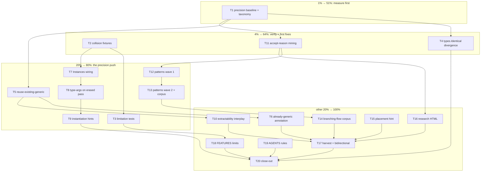

# Generics-Precision from Branching-Flow Lessons — Master Plan

**Date:** 2026-10-11 05:06
**Source:** session analysis of `/home/lars/projects/branching-flow` (esp. generics detection paths) + self-review (`docs/status/2026-10-11_05-02_branching-flow-lessons-self-review.md`, 28 raw items).
**Backlog dedupe:** DONE this session — none of the 28 items exist in `TODO_LIST.md`; the generics-precision cluster directly serves the ROADMAP gate "type-aware + suggest-generics as default (gate 1: precision 12.5% → >50%)"; 4 items merge into existing ROADMAP bullets (irreducibility class, high-similarity warning, recall harness).

---

## 0. Decisions (the 3 open questions from the status report, decided for this plan)

| #  | Question                                                     | Decision                                                                                                                                                                                                                                                                  | Rationale                                                                                                               |
| -- | ------------------------------------------------------------ | ------------------------------------------------------------------------------------------------------------------------------------------------------------------------------------------------------------------------------------------------------------------------- | ----------------------------------------------------------------------------------------------------------------------- |
| Q1 | Route lessons as research HTML, TODO_LIST, or both?          | **Both.** Dated `docs/research/` HTML for the point-in-time lessons (repo policy); TODO_LIST gets the living implementation tasks now (this plan harvests them; pareto-planning skill mandates it).                                                                       | Research docs are snapshots; TODO_LIST is canonical.                                                                    |
| Q2 | `Instances` disambiguation only helps opt-in modes — accept? | **Accept + document.** Wire `types.Info.Instances` into `--type-aware`/`--suggest-generics` only; the default syntax-only pipeline can NEVER disambiguate indexing from instantiation (parser-level ambiguity) — that gets an executable limitation test instead of code. | Only go/types can disambiguate; no point pretending otherwise.                                                          |
| Q3 | May art-dupl grow a corpus-wide generic-decl index?          | **Yes, but syntax-level and bounded.** A `map[name]typeParamCount` collected during the existing parse walk (`TypeParams != nil` scan, no go/types, no new crawl).                                                                                                        | "Reuse existing generic" targets the measured precision problem; a bounded syntax index adds no new architecture class. |

**Guardrail (verschlimmbessern ban):** every task ends with the fast boundary gate (`scripts/check-boundary.sh`); pattern/classification changes additionally re-validate the 5-repo corpus (go-sse, go-cqrs-lite, go-paperless, DiscordSync, art-dupl self) with before/after shown-group counts. The clone-free invariant (Self-Analysis gate) must stay green at every step.

---

## 1. Pareto Breakdown

**Goal state:** `--suggest-generics` precision high enough to unblock the default-flip ROADMAP gate; fewer false clone groups in the field; lower manual `//art-dupl:accept` burden for consumers.

### The 1% that delivers 51%

**T1 — Precision baseline + false-reason taxonomy.** Run `--suggest-generics` over the 5-repo corpus + branching-flow, label every candidate TRUE/FALSE, and categorize WHY the false ones are false (alias-string divergence / instantiation-arg-only / already-generic / min-lines noise / other). ~100min. This single measurement gates everything else: it tells us which of T4/T5/T6/T7 actually moves the number (the ROADMAP explicitly gates the default-flip on this precision figure), and it re-establishes the 12.5% baseline with current code. Without it, the rest of the cluster is guesswork.

### The 4% that delivers 64% (the 1% plus…)

- **T2 — Fixture-verify the instantiation-vs-indexing collision** (semantic cross-file `cache[i]` vs `cache[T]`; structural mode). Last session claimed this FP class from reasoning only, with a wrong example. 45min turns a claim into knowledge.
- **T4 — `types.Identical` divergence comparison** in `ClassifyGenericsCandidate`. Mechanical fix for the alias/import-alias string-equality FP class (go/types already loaded in those modes). Direct precision gain.
- **T11 — Accept-directive reason mining** (art-dupl + branching-flow's 56 directives). 50min grep+table; produces the ranked FP-taxonomy that feeds the actionability waves and quantifies consumer pain.

### The 20% that delivers 80% (the 4% plus…)

- **T5 — Reuse-existing-generic suggestions** (flagship new value: "reuse `Foo[T]`" instead of "extract"; zero new abstraction for the user).
- **T7/T8/T9 — `Instances` wiring, type-args on the erased pass, hint naming** (the instantiation-aware precision trio).
- **T12/T13 — Actionability patterns wave 1+2** from mined reasons (mutex idiom, `flag.Value.Set`, nil-guard-after-helper) with corpus re-validation.
- **T3 — Executable limitation tests** for the documented artifacts (templ `-t 1` whole-file phantom, structural equivalence classes, default-mode ambiguity).

### The other 20% (to 100%)

T6 (already-generic annotation), T10 (extractability interplay), T14 (branching-flow corpus entry), T15 (directive placement near-miss hint), T16 (research HTML), T17 (post-execution harvest + bidirectional check), T18 (FEATURES limitations), T19 (AGENTS.md process rules), T20 (close-out verification).

### Explicitly NOT in this plan (parked → ROADMAP fuel)

Jaccard near-miss ranking score (merges into "high-similarity-no-clone warning"), differs-only-in-tags note, verdict taxonomy in `--explain` (merges into "irreducibility class per group"), `receiverTypeName`-style stripping audit, `astutil.TypeString` limitation cross-check. Recorded in ROADMAP bullet appends (done this session).

---

## 2. Comprehensive Plan (medium granularity, 30–105min per task)

Sorted by importance / impact / effort / customer-value. Tier: P1 = 1%, P4 = 4%, P20 = 20%, REST = other 20%.

| Rank | ID  | Task                                                                                                                                    | Impact | Effort | Customer value                                                              | Depends on | Tier |
| ---- | --- | --------------------------------------------------------------------------------------------------------------------------------------- | ------ | ------ | --------------------------------------------------------------------------- | ---------- | ---- |
| 1    | T1  | Precision baseline + false-reason taxonomy on 6 repos (5 corpus + branching-flow)                                                       | H      | 100m   | Unblocks default-flip gate; every later task sized by it                    | —          | P1   |
| 2    | T2  | Fixture-verify instantiation-vs-indexing collision (semantic + structural)                                                              | H      | 45m    | Correctness knowledge; validates/repudiates last session's claim            | —          | P4   |
| 3    | T4  | `types.Identical` divergence comparison in `ClassifyGenericsCandidate` (alias/import-alias FP fix) + corpus re-validation               | H      | 100m   | Direct precision gain for `--suggest-generics` users                        | T1         | P4   |
| 4    | T5  | Reuse-existing-generic: parse-time generic-decl index → "reuse `Foo[T]`" suggestion (CLI + SDK)                                         | H      | 105m   | Flagship: zero-new-abstraction fix for the FP class consumers hand-annotate | T1         | P20  |
| 5    | T11 | Accept-directive reason mining (2 repos) → frequency table                                                                              | H      | 50m    | Quantified consumer FP burden; feeds T12/T13                                | —          | P4   |
| 6    | T7  | Wire `types.Info.Instances`: instantiation flag on `IndexExpr`/`IndexListExpr`, encoded in type-aware hash                              | H      | 95m    | Kills ambiguity FP class in opt-in modes; prerequisite for T8/T9            | T2         | P20  |
| 7    | T8  | Record instantiation type-args on the erased pass; classifier sees type-arg divergence positions                                        | H      | 75m    | Enables the highest-confidence candidate class                              | T7         | P20  |
| 8    | T9  | Hint naming for instantiation-only divergence + JSON/SARIF fields                                                                       | M      | 45m    | Actionable hints ("list[int] vs list[string]")                              | T8         | P20  |
| 9    | T12 | Actionability patterns wave 1: mutex idiom + `flag.Value.Set`                                                                           | H      | 60m    | Fewer false groups for every consumer repo                                  | T11        | P20  |
| 10   | T13 | Actionability wave 2: nil-guard-after-helper + full 5-repo corpus re-validation                                                         | H      | 90m    | Pattern safety proven on corpus; closes the wave                            | T12        | P20  |
| 11   | T3  | Executable limitation tests (templ `-t 1` phantom, structural equiv, default-mode ambiguity)                                            | M      | 60m    | Drift protection for documented artifacts                                   | T2         | P20  |
| 12   | T6  | Already-generic group annotation ("would be over-engineering")                                                                          | M      | 45m    | Kills the 3-directive class seen in branching-flow                          | T5         | REST |
| 13   | T10 | Extractability interplay: no double-suggest (reuse vs extract)                                                                          | M      | 30m    | No contradictory advice                                                     | T5         | REST |
| 14   | T14 | branching-flow as actionability corpus entry (HEAD numbers)                                                                             | M      | 30m    | 6th validation corpus; tracks a live consumer                               | T13        | REST |
| 15   | T15 | Directive placement near-miss hint (stderr when a directive sits just outside the window)                                               | M      | 60m    | UX fix for the documented placement surprise                                | —          | REST |
| 16   | T16 | `docs/research/` HTML: branching-flow lessons + README index (Q1 decision)                                                              | M      | 60m    | Persistent institutional memory                                             | —          | REST |
| 17   | T17 | Post-execution harvest: TODO_LIST done-marks, ROADMAP merges verified, read branching-flow TODO/ROADMAP for bidirectional generics work | M      | 60m    | Living docs stay canonical; upstream opportunity mapped                     | all        | REST |
| 18   | T18 | FEATURES.md limitation sections (structural equivalence classes, default-mode ambiguity) + count gate                                   | L      | 30m    | Honest docs, CI-enforced                                                    | T3         | REST |
| 19   | T19 | AGENTS.md process rules: fixture-before-behavior-claims; consumer dedup docs = living FP corpus                                         | L      | 30m    | Process debt from the self-review, paid                                     | —          | REST |
| 20   | T20 | Close-out: full boundary gate, CHANGELOG audit, final commit                                                                            | H      | 45m    | Shipped ≠ done until verified                                               | all        | REST |

**Total medium effort:** ~21.5h.

---

## 3. Fine Breakdown (max 12min per subtask)

Grouped under parent tasks; execution order within a group is top-down unless noted. `gate` = fast boundary gate (`scripts/check-boundary.sh`).

### T1 — Precision baseline (P1)

| ID   | Subtask                                                                                                                                       | Est | Depends |
| ---- | --------------------------------------------------------------------------------------------------------------------------------------------- | --- | ------- |
| T1.1 | Scratch runner: `--suggest-generics --no-actionability -t 5 --format json` over go-sse, go-cqrs-lite, go-paperless, DiscordSync; save outputs | 12  | —       |
| T1.2 | Same run on art-dupl self + branching-flow HEAD                                                                                               | 8   | T1.1    |
| T1.3 | Extract candidate table (group, instances, divergent VarType positions, hints) across runs                                                    | 12  | T1.2    |
| T1.4 | Label candidates TRUE/FALSE by reading source — batch 1                                                                                       | 12  | T1.3    |
| T1.5 | Label batch 2                                                                                                                                 | 12  | T1.4    |
| T1.6 | Label batch 3 (+ branching-flow)                                                                                                              | 12  | T1.5    |
| T1.7 | Categorize FALSE reasons: alias-string / instantiation-args-only / already-generic / min-lines noise / other                                  | 12  | T1.6    |
| T1.8 | Precision per repo + overall; compare to 12.5% baseline                                                                                       | 6   | T1.7    |
| T1.9 | Persist `docs/research/2026-10-11_suggest-generics-precision-baseline.md` (numbers + method)                                                  | 12  | T1.8    |

### T2 — Collision fixture verification (P4)

| ID   | Subtask                                                                                                                               | Est | Depends |
| ---- | ------------------------------------------------------------------------------------------------------------------------------------- | --- | ------- |
| T2.1 | Semantic fixture: file A package-level `cache` slice indexed by local; file B imported generic `cache[K]` instantiated — tmp testdata | 12  | —       |
| T2.2 | Run art-dupl on fixture; record collision verdict                                                                                     | 6   | T2.1    |
| T2.3 | Structural fixture: `x[i]` vs `Box[T]` same token shape                                                                               | 12  | T2.2    |
| T2.4 | Pin CURRENT behavior as regression test with limitation comment; record verdict in plan                                               | 12  | T2.3    |

### T3 — Executable limitation tests (P20)

| ID   | Subtask                                                                                                                                                       | Est | Depends |
| ---- | ------------------------------------------------------------------------------------------------------------------------------------------------------------- | --- | ------- |
| T3.1 | Templ `-t 1` whole-file phantom: build the 2-file same-signature fixture from AGENTS.md's documented case                                                     | 12  | T2      |
| T3.2 | Test asserting the phantom group appears at `-t 1` and is invisible at `-t 5`, with CURRENT/EXPECTED/IMPACT comments (branching-flow limitation-test pattern) | 12  | T3.1    |
| T3.3 | Structural-mode test: indexing ≡ instantiation by construction                                                                                                | 12  | T2.4    |
| T3.4 | Default-mode ambiguity doc-test: comment-pinned, links the ROADMAP gate                                                                                       | 12  | T3.3    |
| T3.5 | Suite green + gate                                                                                                                                            | 12  | T3.4    |

### T4 — types.Identical divergence (P4)

| ID   | Subtask                                                                                                                        | Est | Depends |
| ---- | ------------------------------------------------------------------------------------------------------------------------------ | --- | ------- |
| T4.1 | Fixture: alias divergence (`type MyDur = time.Duration`) currently counts as divergent → false candidate                       | 12  | T1      |
| T4.2 | Fixture: import-alias spelling (`pkg.T` vs `p.T`) across files                                                                 | 12  | T4.1    |
| T4.3 | Spike: read `printer/generics*.go` + `generics_parity_test.go`; design comparator seam (types when available, string fallback) | 12  | T4.2    |
| T4.4 | Implement `identicalOrStringFallback` comparator (unit-tested)                                                                 | 12  | T4.3    |
| T4.5 | Wire into `ClassifyGenericsCandidate`; update parity test                                                                      | 12  | T4.4    |
| T4.6 | Output stability: JSON/SARIF bytes unchanged for non-affected groups                                                           | 6   | T4.5    |
| T4.7 | Corpus re-validation 1 (go-sse, go-paperless): candidate counts before/after                                                   | 12  | T4.6    |
| T4.8 | Corpus re-validation 2 (go-cqrs-lite, DiscordSync, self): counts + spot-check deltas                                           | 12  | T4.7    |
| T4.9 | Gate + CHANGELOG entry                                                                                                         | 12  | T4.8    |

### T5 — Reuse-existing-generic (P20)

| ID   | Subtask                                                                                                                 | Est | Depends |
| ---- | ----------------------------------------------------------------------------------------------------------------------- | --- | ------- |
| T5.1 | Design spike: decl index shape (`map[string]int` name→typeParamCount) collected in the existing parse walk; no go/types | 12  | T1      |
| T5.2 | Implement index collection; unit tests                                                                                  | 12  | T5.1    |
| T5.3 | Thread index to printer classification path (arch-lint clean)                                                           | 12  | T5.2    |
| T5.4 | Reuse verdict: divergent position types are instantiations of indexed generic names → `ReuseExistingGeneric`            | 12  | T5.3    |
| T5.5 | Suggestion text "Reuse existing generic `Foo[T]`" + hint field                                                          | 12  | T5.4    |
| T5.6 | Unit tests a: `FooString`-style wrapper + `Foo[T]` present → reuse; generic absent → extract hint unchanged             | 12  | T5.5    |
| T5.7 | Unit tests b: same-package + cross-package name resolution edge cases                                                   | 12  | T5.6    |
| T5.8 | SDK parity (`pkg/artdupl` mirrors the hint)                                                                             | 12  | T5.7    |
| T5.9 | HOW_TO_USE/FEATURES + docs-health count gate alignment; gate                                                            | 12  | T5.8    |

### T6 — Already-generic annotation (REST)

| ID   | Subtask                                                                          | Est | Depends |
| ---- | -------------------------------------------------------------------------------- | --- | ------- |
| T6.1 | Fixture: branching-flow's 1-field generic wrapper case                           | 12  | T5      |
| T6.2 | Rule: every instance already inside/behind generics → annotate, lower confidence | 12  | T6.1    |
| T6.3 | Label + tests                                                                    | 12  | T6.2    |
| T6.4 | Corpus spot-check; gate                                                          | 6   | T6.3    |

### T7 — Instances wiring (P20)

| ID   | Subtask                                                                                            | Est | Depends |
| ---- | -------------------------------------------------------------------------------------------------- | --- | ------- |
| T7.1 | Extend `PreloadedAST`/typeinfo plumbing to carry `types.Info.Instances`                            | 12  | T2      |
| T7.2 | Transformer: flag instantiation `IndexExpr`/`IndexListExpr` via Instances (incl. `SelectorExpr.X`) | 12  | T7.1    |
| T7.3 | Encode instantiation-vs-index via `encodeSemanticType` in type-aware hash                          | 12  | T7.2    |
| T7.4 | `VarType` on index nodes carries the instantiated type string                                      | 12  | T7.3    |
| T7.5 | Tests a: type-aware mode `Box[T]` ≠ `arr[i]`; semantic default unchanged                           | 12  | T7.4    |
| T7.6 | Tests b: selector form `pkg.Box[T]`; non-generic code byte-stable                                  | 12  | T7.5    |
| T7.7 | Cache key/`CacheVersion` decision (stream changed only in type-aware runs — document reasoning)    | 12  | T7.6    |
| T7.8 | Corpus spot-check (type-aware ≡ semantic contract per ROADMAP item); gate                          | 12  | T7.7    |

### T8 — Type-args on erased pass (P20)

| ID   | Subtask                                                                                                 | Est | Depends |
| ---- | ------------------------------------------------------------------------------------------------------- | --- | ------- |
| T8.0 | Re-read Node layout invariants (scalar block rules, `syntax_layout_test.go`) before touching the struct | 12  | T7      |
| T8.1 | Add `Node` field for instantiation type args (scalar/pointer block per rules)                           | 12  | T8.0    |
| T8.2 | `serial()` + `Clone()` preservation; extend `TestSerializePreservesAllFields`                           | 12  | T8.1    |
| T8.3 | `ClassifyGenericsCandidate`: type-arg divergence positions                                              | 12  | T8.2    |
| T8.4 | `MinDivergentPositions` interplay tests (2-position rule with type-arg positions)                       | 12  | T8.3    |
| T8.5 | Gob cache compatibility check (field-name-based, no bump needed — verify)                               | 12  | T8.4    |
| T8.6 | Gate                                                                                                    | 6   | T8.5    |

### T9 — Instantiation hint naming (P20)

| ID   | Subtask                                                                               | Est | Depends |
| ---- | ------------------------------------------------------------------------------------- | --- | ------- |
| T9.1 | Hint renderer: "differs only in generic instantiation: `list[int]` vs `list[string]`" | 12  | T8      |
| T9.2 | JSON `generics_hint` + SARIF property reuse (no new field if hint carries it)         | 12  | T9.1    |
| T9.3 | Text/JSON golden tests                                                                | 12  | T9.2    |
| T9.4 | Docs; gate                                                                            | 6   | T9.3    |

### T10 — Extractability interplay (REST)

| ID    | Subtask                                                                        | Est | Depends |
| ----- | ------------------------------------------------------------------------------ | --- | ------- |
| T10.1 | Test: reuse-suggested groups must not also carry an extraction suggestion/veto | 12  | T5      |
| T10.2 | Fix precedence if conflict (reuse wins; extraction suppressed)                 | 12  | T10.1   |
| T10.3 | Gate                                                                           | 6   | T10.2   |

### T11 — Accept-reason mining (P4)

| ID    | Subtask                                                                                     | Est | Depends |
| ----- | ------------------------------------------------------------------------------------------- | --- | ------- |
| T11.1 | Grep `//art-dupl:accept` in art-dupl + branching-flow (56 there); collect reason strings    | 12  | —       |
| T11.2 | Normalize + frequency table (manual clustering, `HasAllPatterns`-style groups)              | 12  | T11.1   |
| T11.3 | Map top reasons → candidate pattern sketches (mutex, flag.Value.Set, nil-guard, t.Parallel) | 12  | T11.2   |
| T11.4 | Persist table in the T16 research doc data section                                          | 12  | T11.3   |

### T12 — Actionability wave 1 (P20)

| ID    | Subtask                                                                                                       | Est | Depends |
| ----- | ------------------------------------------------------------------------------------------------------------- | --- | ------- |
| T12.1 | Check overlap first: do `test-preamble`/existing patterns already cover `t.Parallel()`? (verdict before code) | 12  | T11     |
| T12.2 | Mutex idiom pattern impl (Lock+defer Unlock / RLock+defer RUnlock pairs)                                      | 12  | T12.1   |
| T12.3 | Mutex pattern tests (incl. non-matching guard: real logic between calls must NOT match)                       | 12  | T12.2   |
| T12.4 | `flag.Value.Set` pattern impl + tests                                                                         | 12  | T12.3   |
| T12.5 | `docs/ACTIONABILITY_PATTERNS.md` rows + docs-health count gate update                                         | 12  | T12.4   |
| T12.6 | Gate + quick self-scan delta (`-t 1` shown groups)                                                            | 12  | T12.5   |

### T13 — Actionability wave 2 + corpus re-validation (P20)

| ID    | Subtask                                                                                  | Est | Depends |
| ----- | ---------------------------------------------------------------------------------------- | --- | ------- |
| T13.1 | Nil-guard-after-helper pattern impl (`x := H(y); if x == nil { return }`)                | 12  | T12     |
| T13.2 | Nil-guard tests + false-positive guard (guards with non-trivial bodies must NOT match)   | 12  | T13.1   |
| T13.3 | Corpus re-validation a: go-sse, go-paperless before/after shown groups                   | 12  | T13.2   |
| T13.4 | Corpus re-validation b: go-cqrs-lite, DiscordSync                                        | 12  | T13.3   |
| T13.5 | Corpus re-validation c: art-dupl self (clone-free invariant) + baseline regen if changed | 12  | T13.4   |
| T13.6 | Pattern docs + count gate; gate                                                          | 12  | T13.5   |
| T13.7 | CHANGELOG entries for waves 1+2                                                          | 12  | T13.6   |

### T14 — branching-flow corpus entry (REST)

| ID    | Subtask                                                           | Est | Depends |
| ----- | ----------------------------------------------------------------- | --- | ------- |
| T14.1 | Validation scan at branching-flow HEAD; record shown-group counts | 12  | T13     |
| T14.2 | Add to AGENTS.md corpus table + actionability doc; gate           | 12  | T14.1   |

### T15 — Directive placement near-miss hint (REST)

| ID    | Subtask                                                                                                                                                         | Est | Depends |
| ----- | --------------------------------------------------------------------------------------------------------------------------------------------------------------- | --- | ------- |
| T15.1 | Reproduce the doc-comment placement case (directive above decl doc, flagged range inside body)                                                                  | 12  | —       |
| T15.2 | Near-miss detector: directive within ~10 lines above LineStart but outside the 5-line window → stderr hint (text/HTML formats only, machine formats stay clean) | 12  | T15.1   |
| T15.3 | Tests a: hint fires in the gap; silent when properly placed                                                                                                     | 12  | T15.2   |
| T15.4 | Tests b: `--quiet` + machine-format cleanliness                                                                                                                 | 12  | T15.3   |
| T15.5 | HOW_TO_USE directive section; gate                                                                                                                              | 12  | T15.4   |

### T16 — Research HTML (REST)

| ID    | Subtask                                                                                | Est | Depends |
| ----- | -------------------------------------------------------------------------------------- | --- | ------- |
| T16.1 | html-report-kit template copy + skeleton; lessons from session report                  | 12  | —       |
| T16.2 | Generics-path sections (5 lessons with branching-flow file:line evidence)              | 12  | T16.1   |
| T16.3 | Beyond-generics sections + accept-reason mining table (T11.4 data)                     | 12  | T16.2   |
| T16.4 | §currency re-review stub + remediation ledger (verdict rows for each lesson → task ID) | 12  | T16.3   |
| T16.5 | `docs/research/README.md` index line; gate                                             | 6   | T16.4   |

### T17 — Post-execution harvest + bidirectional check (REST)

| ID    | Subtask                                                                                                                                   | Est | Depends |
| ----- | ----------------------------------------------------------------------------------------------------------------------------------------- | --- | ------- |
| T17.1 | Mark completed tasks in TODO_LIST; prune superseded lines                                                                                 | 12  | all     |
| T17.2 | Verify ROADMAP merge appends point at landed work; update bullets                                                                         | 12  | T17.1   |
| T17.3 | Read branching-flow TODO_LIST/ROADMAP; record their in-flight generics work + upstream-contribution note (their composition ROADMAP item) | 12  | T17.2   |
| T17.4 | AGENTS.md pointer to this plan + outcomes; docs-freshness check                                                                           | 12  | T17.3   |
| T17.5 | Gate                                                                                                                                      | 12  | T17.4   |

### T18 — FEATURES limitation sections (REST)

| ID    | Subtask                                                                                                    | Est | Depends |
| ----- | ---------------------------------------------------------------------------------------------------------- | --- | ------- |
| T18.1 | Structural-mode equivalence-class limitation section (identifiers ignored → indexing ≡ instantiation etc.) | 12  | T3      |
| T18.2 | Default-mode instantiation ambiguity note + count-gate run; gate                                           | 12  | T18.1   |

### T19 — AGENTS.md process rules (REST)

| ID    | Subtask                                                                                                                                                        | Est | Depends |
| ----- | -------------------------------------------------------------------------------------------------------------------------------------------------------------- | --- | ------- |
| T19.1 | Add conventions: "fixture + run before any detection-behavior claim"; "consumer dedup-acceptance docs are living FP corpora — re-read when touching detection" | 12  | —       |
| T19.2 | Cross-check no duplication with global crush-config; gate                                                                                                      | 12  | T19.1   |

### T20 — Close-out (REST)

| ID    | Subtask                                                              | Est | Depends |
| ----- | -------------------------------------------------------------------- | --- | ------- |
| T20.1 | `scripts/check-boundary.sh --full`                                   | 12  | all     |
| T20.2 | CHANGELOG audit (every shipped task has an entry)                    | 12  | T20.1   |
| T20.3 | Final `git status` clean; commit; nix flake check if build-affecting | 12  | T20.2   |

**Fine total:** 103 subtasks, ~19.7h of estimated fine-grained work (the ~21.5h medium envelope in §2 carries coordination overhead).

---

## 4. Execution Graph

**Recommended execution order:** T1 → T2 → T11 (parallel-safe with T4) → T4 → T5 → T7 → T8 → T9 → T3 → T12 → T13 → then REST in listed order. T19 can run any time; T20 always last.

---

## 5. Verification Contract (every task)

1. Fast boundary gate after every task: `scripts/check-boundary.sh`.
2. Classification/pattern changes (T4, T5, T6, T8, T9, T12, T13): 5-repo corpus before/after shown-group counts recorded in the task's CHANGELOG line.
3. Clone-free invariant: Self-Analysis gate green at all times; `.art-dupl-baseline.json` regenerated only via the documented baseline flow.
4. No new `encoding/json` direct marshaling, no `errors.New` duplicates, sentinels via `domain` (AGENTS.md conventions).
5. Docs count gate (`cmd/docs_health_counts_test.go`) updated WITH the doc change, never the reverse.

## 6. Harvesed Into Living Docs (this session)

- `TODO_LIST.md`: new "Generics-precision cluster" section (implementation tasks, points here).
- `ROADMAP.md`: 4 bullet appends (default-flip gate link, irreducibility-class merge, near-miss-warning merge, recall-harness corpus addition).
