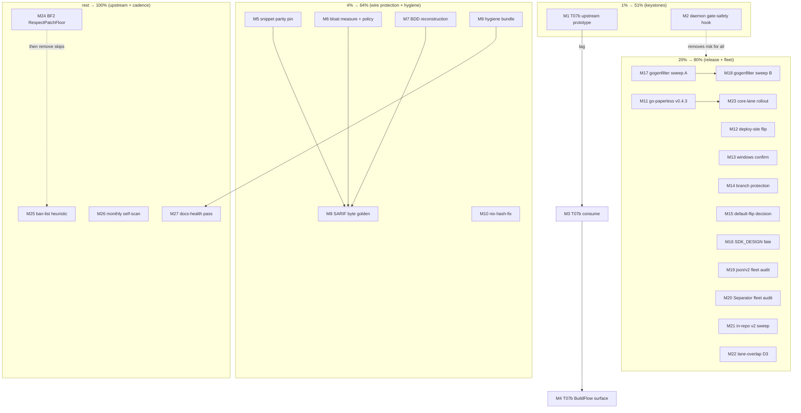

# Open-Work Pareto Master Plan — fleet leverage, infra hardening, release train

**Created:** 2026-10-11 08:29 CEST
**Scope:** ALL open TODO_LIST items EXCEPT the generics-precision cluster (T1–T20), which has its own master plan: [`2026-10-11_05-06_generics-precision-from-branching-flow-lessons.md`](2026-10-11_05-06_generics-precision-from-branching-flow-lessons.md). This plan covers everything else: go-finding leverage follow-ups, infra/daemon hardening, the release train, fleet sweeps, and documentation cadences.
**Sources:** `TODO_LIST.md` (2026-10-11), status report `docs/status/2026-10-11_06-37_go-finding-leverage-deep-dive-sarif-parity-status.md`, deep-dive §06 (`docs/research/2026-10-05_go-finding-deep-dive.html`), AGENTS.md cadence rules.

---

## 0. Guardrails (read before executing anything)

1. **Do NOT verschlimmbessern.** Every change must leave the repo verifiably no worse: gate after each task (`scripts/check-boundary.sh` fast profile; close-outs `--full`).
2. **Owner-gated items are executed as PREPARATION only** (branch-protection recipe drafted, default-flip decision doc written) — the flip/settings themselves wait for the owner answer. Tracked: TODO_LIST (default-flip), status report §g.
3. **Concurrent sessions are live on `fork`.** Run `git status` immediately before editing; never touch another session's in-flight files (2026-10-11 06:15 incident: daemon committed a foreign half-state as `8afa9803`).
4. **Wire conservatism:** SARIF/JSON output changes need golden pins BEFORE consumers calcify on them (today's `relatedLocations`/`snippet` are 24h old — pin them now, task M8).
5. **No bump on a red baseline** (F11): fleet sweeps fix the go-line/build FIRST when the fix IS the bump.

---

## 1. Pareto Breakdown

### The 1% that delivers 51%

Two keystone items. Everything else is either downstream of them or independent value:

| Item | Why it is the 1% |
|---|---|
| **M1 — T07b upstream prototype** (go-finding coverage channel) | The ONLY structural capability gap in the go-finding integration (§06: everything else leveraged). Unblocks two follow-ons (M3, M4) and answers "did the tool see every file?" — the question consumers currently cannot answer from the interchange. Recipe exists in TODO_LIST; nothing art-dupl-side blocks it. |
| **M2 — Daemon gate-safety hook** (pre-commit jsonv2gate + build on daemon commits) | The foreign-in-flight-edit class fired SEVEN times (jsonv2gate recurrences #1–#6 + today's `8afa9803` broken-HEAD). Every occurrence costs session time and once reached the remote (~90 min live, 2026-09-29). One hook kills the entire class permanently. Owner question Q1 pending since 2026-10-05 — this task PROTOTYPES the hook so the decision becomes "merge or veto", not "design". |

### The 4% that delivers 64% (the 1% plus…)

| Item | Why |
|---|---|
| **M5 — SARIF snippet-parity pin/delta** + **M6 — snippet-bloat measurement/policy** + **M8 — byte-level SARIF golden** | Today's wire additions (`relatedLocations`, `region.snippet`) are unpinned at byte level, the related-region snippet parity vs `ToSARIF()` is UNVERIFIED (overclaim risk, status report d4), and output-size growth is unmeasured. 24h window to protect the wire format before consumers depend on accident. |
| **M7 — BDD multi-clone SARIF reconstruction test** | Closes the loop the cross-check doesn't: CLI SARIF (with siblings) → `FindingsFromSARIF` → `Report.GroupFindings()` must reconstruct the exact partition. |
| **M9 — Hygiene bundle** (AGENTS §06 pointer, stale v0.8.0 line close, HARVEST) | Prevents the next session from re-litigating verdicts or cutting a duplicate release. |
| **M10 — nix-hash-fix re-run** | Was blocked on the concurrent session's dependency churn; tree is stable now. Real staleness already detected (ultraviolet pseudo-version). |

### The 20% that delivers 80% (the 4% plus…)

Release train + the two highest-pain fleet items:

- **M11** go-paperless v0.4.3 tag+release (memo exists, pushed 2026-09-19, awaiting tag)
- **M12** deploy-site.yml `continue-on-error` flip (broken sites can deploy TODAY)
- **M13** Windows exe-start confirmation (one green lane run closes a 5-round saga)
- **M14** Branch-protection + failure notifications (red CI sat unnoticed 4 days; recipe ready)
- **M15** `emit-suppressed-accepted` default-flip decision doc (owner answer request)
- **M16** SDK_DESIGN.md fate (stale since 2026-07-19, recurring)
- **M17/M18** gogenfilter v3.6.1 fleet sweep (9 consumers on a known-bad version; go-line-first per F11)
- **M19/M20** Fleet audits: `encoding/json/v2` imports + `filepath.Separator` matching on Go 1.27 (the two fleet-wide bug classes art-dupl already fixed in-repo)
- **M21** art-dupl in-repo remaining ~30 direct v2 imports sweep
- **M22** Lane-overlap measurement D3 (does jscpd backup lane pull weight?)
- **M23** Fleet rollout of the core-lane pattern (next consumer repo)

### The other 20% (to 100%)

Upstream BuildFlow fixes + documentation cadences:

- **M24** BuildFlow BF2: `go-version-auto-configure` RespectPatchFloor (ends the 5× go-line flip war fleet-wide)
- **M25** BuildFlow: `golangci-lint-auto-configure` respect-ban-list heuristic (ends the chronic `disabled-linters` red)
- **M26** Monthly self-scan + SELF_CLEAN_LEDGER append (due ~2026-10-22)
- **M27** Monthly docs-health pass (due 2026-10-28) incl. A-lite→A re-keying

### Explicitly NOT in this plan

- **Generics-precision cluster T1–T20** — own master plan (see header). Referenced only where the corpus re-validations overlap (M19's v2 sweep touches none of its fixtures).
- **PARKED items with unmet entry criteria** (suffix-array detector, per-file offset map, winnowing, TS/Python, watch mode, branded NodeType, facade, `TypeAwareData` restructure) — TODO_LIST §PARKED is explicit-entry by design; not amnesia, not planned.
- **M3/M4 (T07b consumption/surfacing) execution** before M1 lands and tags — they are planned, gated on M1.

---

## 2. Comprehensive Plan (30–100 min per task, sorted by impact/effort/value)

| # | Task | Cluster | Impact | Effort | Depends on |
|---|------|---------|--------|--------|------------|
| M1 | T07b upstream: prototype `DetectResult{Findings, FilesScanned, SkippedModules}` behind optional `DetectorV2` (or coverage ctx channel) in `~/projects/go-finding`, with tests | go-finding | High | L (100m) | — |
| M2 | Daemon gate-safety: prototype a pre-commit hook running `internal/jsonv2gate` + `go build ./...` on daemon-committed trees; write the Q1 decision doc (hook vs exclusion list) | Infra | Critical | L (90m) | — |
| M3 | T07b art-dupl consumption: provider populates FilesScanned/SkippedModules from its crawl; provider tests assert numbers | go-finding | High | M (60m) | M1 tagged |
| M4 | T07b BuildFlow surfacing: report renders real coverage from provider findings | go-finding | High | M (60m) | M3 |
| M5 | Verify ToSARIF related-region snippet behavior; pin parity in cross-check or document accepted delta | go-finding | Medium | S (45m) | — |
| M6 | Measure SARIF output-size growth (snippet duplication) on a real corpus; write the policy decision (everywhere vs primary-only) | go-finding | Medium | S (45m) | — |
| M7 | BDD: multi-clone CLI SARIF → `FindingsFromSARIF` → `GroupFindings()` reconstruction test | go-finding | Medium | S (45m) | — |
| M8 | Byte-level SARIF golden with siblings (relatedLocations + snippet) to freeze the wire shape | go-finding | Medium | S (30m) | M5, M6 |
| M9 | Hygiene: AGENTS deep-dive pointer §05→"§05–§06"; close stale TODO v0.8.0 line (v0.9.0 shipped 2026-10-06); HARVEST status-report §f into TODO_LIST | Docs | Medium | S (40m) | — |
| M10 | Re-run `buildflow -s nix-hash-fix --fix` on the stable tree; commit the vendorHash | Infra | Medium | S (30m) | — |
| M11 | go-paperless v0.4.3: follow the release memo (`docs/planning/2026-09-29_03-10`), verify repo state first, tag + release | Release | High | M (60m) | — |
| M12 | deploy-site.yml: flip `continue-on-error` to failing; run astro check locally to confirm green before merge | Infra | High | S (30m) | — |
| M13 | Windows exe-start (#4): land `-o art-dupl-test.exe` state, watch one windows-lane `TestExitCodes_Process` run, close the line | Infra | Medium | S (30m) | CI cycle |
| M14 | Branch protection: execute the 2026-09-29 recipe for art-dupl (`main`+`fork` required checks by exact job name) + failure notifications; fleet repos listed for later | Infra | High | M (60m) | owner GitHub access |
| M15 | `emit-suppressed-accepted` default-flip: write the decision doc with both options costed; request the owner answer (Q2) | go-finding | Medium | S (30m) | owner input |
| M16 | SDK_DESIGN.md fate: decide rewrite/move/trim; execute; close the recurring item | Docs | Medium | M (60m) | — |
| M17 | gogenfilter v3.6.1 sweep A — broken-build repos FIRST (go-line 1.27 → bump → vendor → test): branching-flow, BuildFlow, auto-deduplicate | Fleet | High | L (100m) | — |
| M18 | gogenfilter v3.6.1 sweep B — remaining 6: erraudit, go-filewatcher, hierarchical-errors, Cyberdom, overview, project-discovery-daemon | Fleet | Medium | L (100m) | M17 pattern proven |
| M19 | Fleet audit `encoding/json/v2` / `format:` tags on every LarsArtmann repo on Go 1.27 (#14) | Fleet | Medium | L (90m) | — |
| M20 | Fleet audit `filepath.Separator` matching + colon-path parsing (#15) — the Windows bug class | Fleet | Medium | L (90m) | — |
| M21 | art-dupl in-repo: migrate remaining ~30 direct `encoding/json/v2` imports where a wire/Duration concern exists | Quality | Low | M (60m) | — |
| M22 | Lane-overlap D3: query jscpd non-Go vs art-dupl Go findings per repo post-soak; verdict on the backup lane | Fleet | Low | S (45m) | fleet uptake |
| M23 | Fleet rollout: pick the next consumer repo for the core-lane pattern (blank-import + registration test + jscpd lane split) | Fleet | Low | M (60m) | M11 (recipe re-proof) |
| M24 | BuildFlow BF2: implement `CanonicalizeOptions.RespectPatchFloor` + formIssues gate + provider-config channel | BuildFlow | High | L (90m) | — |
| M25 | BuildFlow: "respect existing ban list" heuristic in `golangci-lint-auto-configure`; drop art-dupl's `skip_steps` workaround after | BuildFlow | Medium | M (60m) | — |
| M26 | Monthly self-scan: `scripts/self-scan.sh -t 1 --type-aware`, judge every group, append SELF_CLEAN_LEDGER (due ~10-22) | Cadence | Medium | M (60m) | — |
| M27 | Monthly docs-health pass (due 10-28): HARVEST reports, annotate, archive; incl. A-lite→A re-keying of 55 snapshots | Cadence | Medium | L (100m) | M9 |

## 3. Fine Breakdown (max 12 min per subtask, sorted within tasks by dependency)

### M1 — T07b upstream prototype (P1)

| # | Subtask | Min |
|---|---------|-----|
| 1.1 | Skim `toolsdk/` Detect call path + `Report.Summary` serialization in go-finding working copy; confirm the DetectorV2 seam | 12 |
| 1.2 | Write `DetectResult` type + optional `DetectorV2` interface (source-compatible) | 12 |
| 1.3 | Registry/`BuildAll` path: honor DetectorV2 when implemented, fall back to `Detector` | 12 |
| 1.4 | Wire `FilesScanned`/`SkippedModules` into `Report.ComputeSummaryAt` | 12 |
| 1.5 | Unit tests: v2 detector populates coverage; v1 detector leaves zeros (documented) | 12 |
| 1.6 | toolsdk context-channel alternative spike (`WithFileCoverage`) — 30-min spike, pick the shape | 12+12 |
| 1.7 | CHANGELOG + jj-fork-PR-workflow: branch, commit, push, PR (verify-before-filing + github-voice) | 12+12 |
| 1.8 | CI green watch + PR self-review pass | 12 |

### M2 — Daemon gate-safety hook (P2)

| # | Subtask | Min |
|---|---------|-----|
| 2.1 | Reproduce the class: check out `8afa9803`, show `go build ./...` red (evidence for the decision doc) | 12 |
| 2.2 | Write hook script: on commit, run `go build ./...` + jsonv2gate gate on the INDEX tree; refuse on red | 12+12 |
| 2.3 | Wire into the daemon's commit path (pma config or pre-commit hook owned by the daemon) | 12 |
| 2.4 | Prove it: recreate a broken index state, observe the hook refuse | 12 |
| 2.5 | Decision doc `docs/status/…daemon-gate-q1-decision.md`: hook vs exclusion list, costed; request owner answer | 12 |
| 2.6 | Debit the 7 recurrences in the doc (evidence links) + record in AGENTS.md once owner approves | 12 |

### M3 — T07b art-dupl consumption (P3, after M1 tag)

| # | Subtask | Min |
|---|---------|-----|
| 3.1 | Bump go-finding pins to the tagged release; vendorHash refresh | 12 |
| 3.2 | Implement `DetectorV2` on `cloneDetector`: files parsed count + skipped nested modules from the crawl | 12 |
| 3.3 | Thread crawl counters from `collectSourceFiles` into the detector result | 12 |
| 3.4 | Provider tests assert real coverage numbers on fixtures (incl. nested go.mod skip case) | 12 |
| 3.5 | Boundary gate + provider golden refresh if IDs/positions shifted | 12 |

### M4 — T07b BuildFlow surfacing (P4, after M3)

| # | Subtask | Min |
|---|---------|-----|
| 4.1 | Locate BuildFlow report renderer for coverage; wire FilesScanned/SkippedModules through | 12+12 |
| 4.2 | E2E on a fixture repo; assert "did we see every file" renders truthfully | 12 |
| 4.3 | BuildFlow CHANGELOG + commit on its master | 12 |

### M5 — Snippet parity pin/delta (P5)

| # | Subtask | Min |
|---|---------|-----|
| 5.1 | Read upstream `sarif_export.go` related-region construction: does `region.Snippet` get set for related entries? | 12 |
| 5.2 | If yes: extend `TestSARIFCrossCheckRelatedLocations` to compare snippets; if no: document the delta on the CLI type + in §06 ledger | 12 |
| 5.3 | Run cross-check tests; boundary fast profile | 12 |

### M6 — Snippet bloat measurement + policy (P6)

| # | Subtask | Min |
|---|---------|-----|
| 6.1 | Generate SARIF for a real corpus (self-scan target) with/without related snippets; record sizes | 12 |
| 6.2 | Compute growth % at -t 1 and default threshold; capture numbers in a bench note under `docs/benchmarks/` | 12 |
| 6.3 | Write the policy decision (everywhere vs primary-only) into the deep-dive §06 ledger; implement if it says trim | 12 |

### M7 — BDD multi-clone reconstruction (P7)

| # | Subtask | Min |
|---|---------|-----|
| 7.1 | Extend `bdd/sarif_gofinding_integration_test.go`: multi-clone fixture with siblings through the CLI SARIF printer | 12 |
| 7.2 | Parse via `FindingsFromSARIF`, `WithIncludeSuppressed` untouched; assert `GroupFindings()` partitions exactly | 12 |
| 7.3 | Run bdd suite + boundary gate | 12 |

### M8 — Byte-level SARIF golden (P8)

| # | Subtask | Min |
|---|---------|-----|
| 8.1 | Add golden fixture: 2-clone group rendered through `NewSARIF` (full bytes incl. relatedLocations + snippet) | 12 |
| 8.2 | `-update` flag wiring if the package lacks it (check `cmd` golden pattern) | 12 |
| 8.3 | Assert stability across two runs (determinism: no timestamps in the compared region) | 12 |

### M9 — Hygiene bundle (P9)

| # | Subtask | Min |
|---|---------|-----|
| 9.1 | AGENTS.md: deep-dive pointer "§05" → "§05–§06" | 2 |
| 9.2 | TODO_LIST: strike the stale v0.8.0 release line with v0.9.0 evidence (done in this plan's commit) | 5 |
| 9.3 | HARVEST status-report §f items into TODO_LIST (G-cluster added in this commit; verify nothing missed) | 12 |
| 9.4 | Re-run `scripts/check-boundary.sh` fast profile | 12 |

### M10 — nix-hash-fix re-run (P10)

| # | Subtask | Min |
|---|---------|-----|
| 10.1 | `buildflow -s nix-hash-fix --fix`; inspect the diff (ultraviolet pseudo-version hash) | 12 |
| 10.2 | `nix build .#art-dupl` green; commit hash | 12 |
| 10.3 | Close the TODO_LIST line 77 caveat if fully verified | 5 |

### M11 — go-paperless v0.4.3 (P11)

| # | Subtask | Min |
|---|---------|-----|
| 11.1 | Verify repo state vs memo (2026-09-29 HEAD drift check) | 12 |
| 11.2 | Cut CHANGELOG section v0.4.3 (two fixes, no API surface) | 12 |
| 11.3 | Tag + push; watch CI | 12+12 |
| 11.4 | Verify pkg.go.dev + proxy propagation; close TODO #20 | 12 |

### M12 — deploy-site flip (P12)

| # | Subtask | Min |
|---|---------|-----|
| 12.1 | Remove `continue-on-error` from the astro check step | 5 |
| 12.2 | `astro check` locally (website/ pnpm workspace) to prove green before landing | 12 |
| 12.3 | Commit; watch the next site workflow run | 12 |

### M13 — Windows exe-start confirm (P13)

| # | Subtask | Min |
|---|---------|-----|
| 13.1 | Confirm the `-o art-dupl-test.exe` fix is on the branch CI runs | 5 |
| 13.2 | Trigger/watch one windows-lane `TestExitCodes_Process`; close TODO #4 on green | 12+12 |

### M14 — Branch protection (P14)

| # | Subtask | Min |
|---|---------|-----|
| 14.1 | art-dupl `main`+`fork`: classic rule, required checks by exact job names (recipe list), include-administrators | 12+12 |
| 14.2 | Notifications: failed-workflow emails on | 12 |
| 14.3 | Weekly `gh run list --limit 20` sweep — schedule note in TODO_LIST | 12 |
| 14.4 | Fleet repos: start with the 11 listed; document progress (owner-gated, batchable) | 12 |

### M15 — Default-flip decision doc (P15)

| # | Subtask | Min |
|---|---------|-----|
| 15.1 | Cost both options (BuildFlow per-repo M70 mapping vs provider default flip) with the byte-identity pin implications | 12+12 |
| 15.2 | Ask the owner (Q2); record the answer in TODO_LIST + AGENTS when it lands | 12 |

### M16 — SDK_DESIGN.md fate (P16)

| # | Subtask | Min |
|---|---------|-----|
| 16.1 | Diff its claims vs ADR-0025 + pkg/artdupl reality; list stale sections | 12 |
| 16.2 | Decide: trim-in-place vs move to docs/ vs delete (recommend trim + pointer from README) | 12 |
| 16.3 | Execute; close the recurring line | 12+12 |

### M17 — gogenfilter sweep A (P17, build-red repos first)

| # | Subtask | Min |
|---|---------|-----|
| 17.1 | branching-flow: go line 1.27 → bump gogenfilter/v3 v3.6.1 → vendor → `go test ./...` → push | 12+12+12 |
| 17.2 | BuildFlow: same checklist (mind its own preflight warnings) | 12+12 |
| 17.3 | auto-deduplicate: same checklist (build failures per M17 diagnosis) | 12+12 |
| 17.4 | Record per-repo outcomes in the TODO line (which baselines cleared) | 12 |

### M18 — gogenfilter sweep B (P18)

| # | Subtask | Min |
|---|---------|-----|
| 18.1–18.6 | Per repo (erraudit, go-filewatcher [go-line FIRST per F11], hierarchical-errors, Cyberdom, overview, project-discovery-daemon): go-line → bump → vendor → test → push | 12 each |
| 18.7 | Update the TODO sweep line: 9/9 done or exceptions documented | 12 |

### M19 — Fleet audit: encoding/json/v2 (#19 of plan, TODO #14) (P19)

| # | Subtask | Min |
|---|---------|-----|
| 19.1 | Build the repo list (Go 1.27 consumers): grep go.mod across ~/projects | 12 |
| 19.2 | Per repo: grep direct v2 imports + `format:` tags; classify breakage risk | 12×N (cap 5 repos/session) |
| 19.3 | Record findings in the audit line; file fixes where red | 12 |

### M20 — Fleet audit: filepath.Separator (#15) (P20)

| # | Subtask | Min |
|---|---------|-----|
| 20.1 | Same repo list; grep `filepath.Separator` in path MATCHING + `strings.Split(_, ":")` parsing | 12 |
| 20.2 | Per-repo verdicts (mirrors the crawl slash-normalization invariant); file fixes | 12×N |
| 20.3 | Update TODO #15 with the sweep table | 12 |

### M21 — In-repo v2 import sweep (P21)

| # | Subtask | Min |
|---|---------|-----|
| 21.1 | List the ~30 files (jsonv2gate allowlist + grep); classify Duration/wire-bearing | 12 |
| 21.2 | Migrate the Duration/wire-bearing ones to v1 API (batch of ≤8 files/slice) | 12×2 |
| 21.3 | Shrink the jsonv2gate rationale list; run full suite + boundary `--full` | 12+12 |

### M22 — Lane-overlap D3 (P22)

| # | Subtask | Min |
|---|---------|-----|
| 22.1 | Collect jscpd non-Go + art-dupl Go finding counts per repo post-soak | 12+12 |
| 22.2 | Verdict: keep/kill the backup lane; record in TODO line + BuildFlow config note | 12 |

### M23 — Fleet rollout core-lane (P23)

| # | Subtask | Min |
|---|---------|-----|
| 23.1 | Pick the next repo (Go-duplication-sensitive consumer) | 12 |
| 23.2 | Blank-import + registration test + jscpd lane split per recipe; budget line like D2 | 12×3 |
| 23.3 | Soak + record | 12 |

### M24 — BuildFlow BF2 RespectPatchFloor (P24)

| # | Subtask | Min |
|---|---------|-----|
| 24.1 | Read BF2 TODO + the recorded knob design; write failing test for patch-pin stripping | 12+12 |
| 24.2 | Implement `CanonicalizeOptions.RespectPatchFloor` + formIssues gate | 12+12 |
| 24.3 | Provider-config channel for the skip (the missing piece in the diagnosis) | 12 |
| 24.4 | Prove on art-dupl: full format run preserves `go 1.27.1` with skips REMOVED | 12 |
| 24.5 | Remove art-dupl's two `skip_steps` after upstream ships; commit both repos | 12 |

### M25 — BuildFlow ban-list heuristic (P25)

| # | Subtask | Min |
|---|---------|-----|
| 25.1 | Failing test: auto-configure re-adds exhaustruct/tagliatelle over a repo ban | 12 |
| 25.2 | Implement respect-ban-list heuristic | 12+12 |
| 25.3 | Re-verify art-dupl `disabled-linters` check green WITHOUT the skip; remove the skip | 12+12 |

### M26 — Monthly self-scan (P26, due ~2026-10-22)

| # | Subtask | Min |
|---|---------|-----|
| 26.1 | `scripts/self-scan.sh -t 1 --type-aware` on art-dupl | 12 |
| 26.2 | Judge every shown group (extract harmful / accept intentional); append SELF_CLEAN_LEDGER | 12×2 |
| 26.3 | Boundary gate close-out | 12 |

### M27 — Monthly docs-health (P27, due 2026-10-28)

| # | Subtask | Min |
|---|---------|-----|
| 27.1 | HARVEST recent status reports into TODO_LIST | 12×2 |
| 27.2 | Annotate resolved items inline (`scripts/annotate-status-items.py --emit-keys`) | 12×2 |
| 27.3 | Archive fully-done snapshots; archive-gate checks green | 12 |
| 27.4 | A-lite→A re-keying batch 1 (dated banners → grammar keys) | 12×2 |
| 27.5 | Freshness gate + count gate green; record pass verdicts in `docs/status/` | 12 |

---

## 4. Execution Graph

**Critical path:** M1 → M3 → M4 (the coverage channel end-to-end). **Parallel-safe:** M2, M5–M10 are independent of everything in Tier 3/4 and can run as filler between CI waits.

---

## 5. Verification & gates

- After EVERY task: `scripts/check-boundary.sh` (fast profile). Close-outs: `--full`.
- Wire changes (M5–M8): golden + cross-check + BDD suite green before push.
- Fleet tasks: per-repo `go test ./...` green BEFORE push (F11 — no bump on red; fix the baseline first when the fix IS the bump).
- Cadence tasks append to their ledgers (`docs/SELF_CLEAN_LEDGER.md`, pass verdicts in `docs/status/`).

## 6. Residual risks / unknowns

1. Owner answers (Q1 hook vs exclusion list; Q2 default-flip; GitHub settings access for M14) gate the FINAL step of M2/M14/M15 — preparation is unblocked.
2. M22 depends on fleet soak time; if uptake is too fresh, defer to the next plan cycle rather than measuring noise.
3. The generics session may still be editing `TODO_LIST.md`/planning docs concurrently — re-check `git status` before each TODO_LIST touch (guardrail 3).
