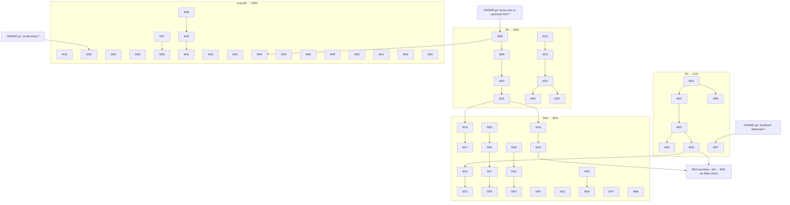

# Execution Plan: Fleet Lib Review Outcomes — Pareto Breakdown

**2026-11-23 01:28 · art-dupl @ fork · basis: `docs/status/2026-11-23_01-21_fleet-lib-review-status.md` §f (50 items) + TODO_LIST T20/G9/G11**

**What this plan IS:** every TODO surfaced by the 2026-11-22/23 fleet library review, ranked by Pareto tiers, split into 30–100min tasks (table 1) and ≤12min micro-tasks (table 2), with an execution graph. Nothing here re-researches the audit — all facts are pinned in `docs/review/libs/*.md` (citation-swept, exit 0).

**What this plan is NOT:** a license to verschlimmbessern. Guardrails: (1) the two struck rows G8/T07b stay struck — their remaining halves live in T20; (2) foreign in-flight files (`cmd/baseline_identity.go` was modified by another session at plan time) are leases, never touched; (3) every task that touches Go source ends with a fresh `-count=1` suite; (4) T20b (core bump) happens BEFORE T20c (propertyBag/Relativize) — those APIs don't exist at the v1.15.0 pin; (5) owner-gated items (g1–g3 answers) are BLOCKED-ON-OWNER, worked around, not worked through.

**Pareto of the result** ("go-finding adoption deltas are real product behavior, repo invariants are mechanically protected, the review corpus stays maintainable"):

| Tier     | Share of items     | Cumulative result | Items (report §f refs)                                                                                                                                                                                                                                                               |
| -------- | ------------------ | ----------------- | ------------------------------------------------------------------------------------------------------------------------------------------------------------------------------------------------------------------------------------------------------------------------------------ |
| **1%**   | 2 of 50 (4%)       | **51%**           | f1 DetectV2+FilesScanned (P25 — the ONLY item that changes what BuildFlow's users see), f14 `.buildflow.yml` skip canary (protects the invariant behind 18 recorded jsonv2 incidents)                                                                                                |
| **4%**   | 4 of 50 (8%)       | **64%**           | 1% + f2 core bump v1.16.0 (unlocks Relativize/propertyBag, kills the mixed pin), f5 typed-accessor swap (deletes the hand-rolled option split-brain)                                                                                                                                 |
| **20%**  | 11 of 50 (22%)     | **80%**           | 4% + f3/f4 (propertyBag + Relativize adoption), f10 (BuildFlow consumes coverage — closes T07b end-to-end), f11–f13 (sweep gate: self-test, globs, flake lane — kills the ghost system), f18 (upstream stamp-defect filing), f16 (G11 re-audit/strike), f41 (harvest into TODO_LIST) |
| **100%** | the other 39 items | last 20%          | long tail: hygiene, docs, cross-repo coordination, cosmetic, skill feedback — table 2 tiers P4                                                                                                                                                                                       |

---

## Table 1 — Comprehensive Plan (30–100min tasks, sorted by impact/effort/value)

| #  | Task                                                                            | Min | Items                   | Tier | Why it matters / exit condition                                                                                                                                                                                                                                                                                                                        |
| -- | ------------------------------------------------------------------------------- | --- | ----------------------- | ---- | ------------------------------------------------------------------------------------------------------------------------------------------------------------------------------------------------------------------------------------------------------------------------------------------------------------------------------------------------------ |
| 1  | **Implement `DetectV2` in the provider** (coverage evidence at the current pin) | 60  | f1,f7,f8                | 1%   | BuildFlow renders `filesScanned: 0` today — indistinguishable from a real zero. Exit: `cloneDetector.DetectV2` returns `DetectResult{Findings, FilesScanned}` from the crawl count; test asserts >0; suite green. No bump, no wire change.                                                                                                             |
| 2  | **`.buildflow.yml` skip canary test**                                           | 30  | f14,g3                  | 1%   | Daemon commit `8ce90a47` silently deleted the `go-auto-upgrade` skip once (recurrence-#18 protection gone until `fb34125f` repaired it). Exit: a plain Go test fails when `skip_steps` loses `go-auto-upgrade`/`golangci-lint-auto-configure`. Blocked-on-owner: only if g3 answer says the deletion was deliberate.                                   |
| 3  | **Bump go-finding core `v1.15.0 → v1.16.0`**                                    | 45  | f2,f9                   | 4%   | API verified in-tag (`git show v1.16.0:report.go`); tag is fetchable despite the [Unreleased] CHANGELOG stamp defect. Exit: go.mod bumped, vendorHash refreshed, fresh `-count=1` suite green, golden diff reviewed. Order decision pending g2 (bump now vs upstream fix first) — plan assumes bump-now.                                               |
| 4  | **Typed accessor swap (option plumbing)**                                       | 40  | f5,f6,f48               | 4%   | `IntFromContext`/`BoolFromContext` (v1.16.0 at pin) replace ~40 hand-rolled lines with fleet semantics (`ErrOptionKindMismatch`). Exit: helpers gone, wrong-kind test added, `emit-suppressed-accepted` default stays byte-identical.                                                                                                                  |
| 5  | **Adopt propertyBag + Relativize** (after task 3)                               | 60  | f3,f4                   | 20%  | `SetRunProperty("art-dupl/threshold"/"mode")` once per run; `Relativize(findings, dir)` makes provider IDs checkout-independent (kills host-path leakage; upstream issue #47). Exit: golden regen diff reviewed (ID changes are INTENDED).                                                                                                             |
| 6  | **Citation-sweep gate engineering** (kill the ghost system)                     | 90  | f11,f12,f13,f45         | 20%  | `--self-test` mode (would have caught my own syntax break), default glob + both README targets, flake check lane, noise audit over docs/status before CI-gating. Exit: stale citation fails CI.                                                                                                                                                        |
| 7  | **TODO_LIST hygiene + harvest**                                                 | 60  | f16,f17,f23,f26,f40,f41 | 20%  | G11 re-audit vs v1.16.0 accessors (strike or keep); scan for other silently-shipped upstream halves (G9 re-check); T20 → M-numbered slices; dated refresh triggers; harvest this plan; docs-health cadence 2026-12-14 row.                                                                                                                             |
| 8  | **Upstream engagement: go-finding**                                             | 100 | f18,f28,f29             | 20%  | (a) stamp-defect issue (verify-before-filing → github-voice); (b) discussion: consumer-side config-policy intent (linter-autoconfigure-sdk flip trigger); (c) discussion: coverage-pattern consolidation (toolsdk DetectV2 vs go-linter-sdk CoverageReporter — one should win fleet-wide). Exit: 1 issue + 2 discussions filed, links recorded in T20. |
| 9  | **BuildFlow consumes coverage evidence** (cross-repo, after task 1)             | 90  | f10                     | 20%  | The T07b loop's last mile: BuildFlow's tool report renders art-dupl's FilesScanned. Exit: lane-soaked — default ≠ 0 for a non-empty scan, typo'd option still fails loudly.                                                                                                                                                                            |
| 10 | **Close-out gates: full race suite + flake check**                              | 100 | f15                     | 20%  | Fast profile ran on docs; the close-out rule wants `check-boundary.sh --full` + `nix flake check` after Go source tasks land.                                                                                                                                                                                                                          |
| 11 | **SkippedModules posture decision**                                             | 30  | f19                     | 4    | Emit empty vs skip nested go.mod trees; the cross-module-clone verdict argues never-skip. Exit: one-paragraph decision recorded in T20 errata.                                                                                                                                                                                                         |
| 12 | **`linter-autoconfigure-sdk audit` trial** (zero-dep value)                     | 30  | f22                     | 4    | `go run cmd/audit` against art-dupl's own `.golangci.yml` for dead-linter references — free value without adopting the dependency.                                                                                                                                                                                                                     |
| 13 | **FEATURES + glossary + policy rows**                                           | 45  | f21,f36,f20             | 4    | FEATURES "Worth considering" rows for the 5 NOT-ADOPTED libs (with flip triggers); DOMAIN_LANGUAGE rows for mixed-pin + stamp defect; record g1 answer (model policy) in AGENTS.md — BLOCKED-ON-OWNER for the g1 half.                                                                                                                                 |
| 14 | **Release + go-compliance pin hygiene**                                         | 60  | f24,f50                 | 4    | Cut the next art-dupl release so go-compliance's dupl-gate pins a real version instead of the v0.9.1 pseudo-version; record the fleet-review checkout pins as an inventory row.                                                                                                                                                                        |
| 15 | **Mixed-pin fleet audit**                                                       | 60  | f31                     | 4    | Check go-compliance + BuildFlow go.mod for core/toolsdk skew (the mixed-pin lesson generalized). Exit: skew table, bumps filed where found.                                                                                                                                                                                                            |
| 16 | **Proxy fetchability lane**                                                     | 30  | f34                     | 4    | `go mod download github.com/larsartmann/go-finding@v1.16.0` in CI proves the TAG, not just the local git object.                                                                                                                                                                                                                                       |
| 17 | **Dashboard polish**                                                            | 30  | f25,f37,f38,f30         | 4    | Link contrast (vision-QC caveat), band column, per-row group provenance; READMEs point to the dashboard as the canonical verdict home (shrinks the split brain).                                                                                                                                                                                       |
| 18 | **Index-drift derivation**                                                      | 60  | f33                     | 4    | Derive `docs/review/README.md` version cells from report header tables — kills the manual-sync drift class.                                                                                                                                                                                                                                            |
| 19 | **Sweep content anchors**                                                       | 90  | f32                     | 4    | Optional `path:line ~expected-token` verification for high-stakes citations (existence+bounds ≠ truth).                                                                                                                                                                                                                                                |
| 20 | **Sweep submodule-tag handling**                                                | 30  | f44                     | 4    | `analysis/v1.15.1`-style refs near-miss the citation regex; handle or explicitly whitelist.                                                                                                                                                                                                                                                            |
| 21 | **SDK-lane SetRunProperty evaluation**                                          | 30  | f47                     | 4    | Should `printer/finding` `Options.Threshold` also ride `SetRunProperty` for SDK consumers? Exit: yes/no + one-line rationale in T20.                                                                                                                                                                                                                   |
| 22 | **Review-corpus aging policy + standing-rule errata**                           | 60  | f42,f39,f27,f49         | 4    | Archive ritual decision for `docs/review/` (mirror status/archived only if corpus grows); README-screenshot guard note; NOT-ADOPTED reopen rules verified in place; `analysis/` N/A verdict re-dated.                                                                                                                                                  |
| 23 | **Skill feedback: fleet-runbook addendum** (cross-repo)                         | 60  | f43                     | 4    | Feed the brief template + sweep-gate pattern back into `library-deep-dive` SKILL.md (SKILLS repo, separate session).                                                                                                                                                                                                                                   |
| 24 | **`exhaustruct_v5` documentation**                                              | 30  | f35                     | 4    | Confirm `.golangci.yml:358` is the intended settings-key form (guard says OK) and document why it differs from the banned enable-list name in AGENTS.md lint section.                                                                                                                                                                                  |

**Sum ≈ 24 tasks / ~29.5h.** Every one of the 50 items maps into exactly one task (mapping in table 2).

---

## Table 2 — Micro Breakdown (≤12min each, ALL items, same sort)

| ID  | Micro-task                                                                   | Min | Items       | Task | Deps    |
| --- | ---------------------------------------------------------------------------- | --- | ----------- | ---- | ------- |
| M01 | Read `go-finding/detect_result.go` + `RunDetect` contract at the v1.15.0 pin | 10  | f1          | 1    | —       |
| M02 | Map DetectV2 shape onto `pkg/provider/crawl.go` file count                   | 8   | f1          | 1    | M01     |
| M03 | Implement `cloneDetector.DetectV2` → `DetectResult{Findings, FilesScanned}`  | 12  | f1          | 1    | M02     |
| M04 | Provider test: `FilesScanned > 0` on a fixture dir                           | 12  | f7          | 1    | M03     |
| M05 | Smoke-compile `examples/detectorv2` against the pin                          | 10  | f8          | 1    | M01     |
| M06 | Fresh `go test -count=1` + boundary fast on provider change                  | 12  | f1          | 1    | M03,M04 |
| M07 | Write `TestBuildflowSkipsPresent` canary (asserts both skip_steps entries)   | 12  | f14,g3      | 2    | —       |
| M08 | `go get github.com/larsartmann/go-finding@v1.16.0`                           | 5   | f2          | 3    | g2      |
| M09 | vendorHash refresh dance (`""` → build → paste `got:`)                       | 12  | f2          | 3    | M08     |
| M10 | Fresh `go test -count=1 ./...` post-bump                                     | 12  | f2          | 3    | M09     |
| M11 | Provider golden diff review post-bump                                        | 10  | f9          | 3    | M10     |
| M12 | Swap `thresholdFromContext` → `toolsdk.IntFromContext`                       | 12  | f5          | 4    | —       |
| M13 | Swap `boolOptionFromContext` → `toolsdk.BoolFromContext`                     | 10  | f5          | 4    | M12     |
| M14 | Wrong-kind option test (`ErrOptionKindMismatch` path)                        | 12  | f6          | 4    | M13     |
| M15 | D1 assert: options stay declaration-only under the swap                      | 12  | f48         | 4    | M14     |
| M16 | `SetRunProperty("art-dupl/threshold", …)` in `ToReport` lane                 | 12  | f3          | 5    | M11     |
| M17 | `SetRunProperty("art-dupl/mode", …)` (+ evaluate SDK-lane threshold)         | 12  | f3,f47      | 5,21 | M16     |
| M18 | `Relativize(findings, dir)` at end of provider `Detect`                      | 10  | f4          | 5    | M11     |
| M19 | Golden regen (ids change intended) + wire-diff review                        | 12  | f4          | 5    | M18     |
| M20 | `emit-suppressed-accepted` default byte-identical parity test                | 12  | f46         | 4    | M14     |
| M21 | BuildFlow slice 1: locate tool-report renderer for FilesScanned              | 12  | f10         | 9    | M06     |
| M22 | BuildFlow slice 2: wire + lane-soak (default ≠ 0)                            | 12  | f10         | 9    | M21     |
| M23 | Stamp-defect issue draft (verify-before-filing checklist)                    | 12  | f18         | 8    | —       |
| M24 | github-voice pass + file the core CHANGELOG issue                            | 12  | f18         | 8    | M23     |
| M25 | Sweep `--self-test` mode (embedded probes incl. ambiguous basename)          | 12  | f13         | 6    | —       |
| M26 | Sweep default glob: add both README targets                                  | 8   | f12         | 6    | M25     |
| M27 | Flake check lane for the citation sweep                                      | 12  | f11         | 6    | M26     |
| M28 | Sweep noise audit over docs/status corpus                                    | 12  | f45         | 6    | M27     |
| M29 | Harvest plan rows into TODO_LIST (docs-health grammar)                       | 12  | f41         | 7    | —       |
| M30 | G11 re-audit vs typed accessors; strike or keep with evidence                | 12  | f16         | 7    | —       |
| M31 | Scan TODO_LIST for other silently-shipped upstream halves                    | 12  | f17         | 7    | —       |
| M32 | T20 → M-slice numbering + dated refresh-trigger row                          | 10  | f23         | 7    | M29     |
| M33 | SkippedModules posture note (empty vs skip; cross-module verdict)            | 12  | f19         | 11   | —       |
| M34 | Record g1 answer (model policy) in AGENTS.md                                 | 12  | f20         | 13   | OWNER   |
| M35 | FEATURES "Worth considering" rows for the 5 NOT-ADOPTED libs                 | 12  | f21         | 13   | —       |
| M36 | `go run cmd/audit` trial vs art-dupl's own `.golangci.yml`                   | 12  | f22         | 12   | —       |
| M37 | Next art-dupl release prep (changelog/verify slice)                          | 12  | f24         | 14   | —       |
| M38 | go-compliance dupl-gate pin coordination + fleet-pins inventory row          | 12  | f24,f50     | 14   | M37     |
| M39 | Dashboard report-link contrast fix                                           | 10  | f25         | 17   | —       |
| M40 | Dashboard band column + per-row group provenance                             | 12  | f37,f38     | 17   | M39     |
| M41 | READMEs point to dashboard as canonical verdict home                         | 10  | f30         | 17   | M40     |
| M42 | Mixed-pin audit: go-compliance + BuildFlow go.mod skew                       | 12  | f31         | 15   | —       |
| M43 | Derive review-README version cells from report headers                       | 12  | f33         | 18   | —       |
| M44 | `go mod download go-finding@v1.16.0` fetchability lane                       | 10  | f34         | 16   | M08     |
| M45 | Document `exhaustruct_v5` settings-key rationale                             | 10  | f35         | 24   | —       |
| M46 | DOMAIN_LANGUAGE rows: mixed-pin, stamp defect                                | 10  | f36         | 13   | —       |
| M47 | Draft upstream discussion: consumer config-policy intent                     | 12  | f28         | 8    | —       |
| M48 | Draft upstream discussion: coverage one-wins consolidation                   | 12  | f29         | 8    | —       |
| M49 | Fleet-runbook addendum to library-deep-dive skill (SKILLS repo)              | 12  | f43         | 23   | —       |
| M50 | Sweep: submodule-qualified tag near-miss handling                            | 12  | f44         | 20   | M25     |
| M51 | Review-corpus archive policy + reopen-rule verify + README-shot guard        | 12  | f42,f39,f27 | 22   | —       |
| M52 | `analysis/` N/A verdict re-dating errata                                     | 10  | f49         | 22   | —       |
| M53 | Per-train re-audit policy + docs-health 2026-12-14 cadence row               | 10  | f26,f40     | 7    | M32     |
| M54 | Close-out: `scripts/check-boundary.sh --full`                                | 12  | f15         | 10   | 1–5     |
| M55 | Close-out: `nix flake check`                                                 | 12  | f15         | 10   | M54     |
| M56 | Sweep content-anchor extension (`path:line ~token`)                          | 12  | f32         | 19   | M25     |

**56 micro-tasks ≈ 10.4h pure execution + gate waits.** Coverage check: report §f items 1–50 all map (f1→M01–06, f2→M08–11, f3→M16–17, f4→M18–19, f5→M12–13, f6→M14, f7→M04, f8→M05, f9→M11, f10→M21–22, f11→M27, f12→M26, f13→M25, f14→M07, f15→M54–55, f16→M30, f17→M31, f18→M23–24, f19→M33, f20→M34, f21→M35, f22→M36, f23→M32, f24→M37–38, f25→M39, f26→M53, f27→M51, f28→M47, f29→M48, f30→M41, f31→M42, f32→M56, f33→M43, f34→M44, f35→M45, f36→M46, f37→M40, f38→M40, f39→M51, f40→M53, f41→M29, f42→M51, f43→M49, f44→M50, f45→M28, f46→M20, f47→M17, f48→M15, f49→M52, f50→M38).

---

## Execution Graph

**Critical path:** M01→M03→M04→M06 → M08→M09→M10→M11 → M16/M18→M19 → close-out gates. Everything in TIER 4 is parallelizable filler between gate waits. Three gates are BLOCKED-ON-OWNER (M07, M08, M34) — work around them, never through them: if g2/g3 answers are pending, start the unblocked TIER-3 sweep engineering (M25–M28) instead.

---

## Errata & standing rules (read before executing)

1. **Verified still open at plan time (2026-11-23 01:28):** G9 (TODO_LIST:72), G11 (:74), T20 (:114). G8/T07b stay struck — do NOT resurrect.
2. **Foreign lease:** `cmd/baseline_identity.go` was modified in the worktree by another session at plan time — not part of this plan, never staged by it.
3. **The sweep gate is trustworthy only as far as its last self-test** — M25 exists because its author broke it once (recurrence: status report §d1).
4. **Priority sort used:** customer-visible value first (BuildFlow reports), invariant protection second, fleet-consistency third, docs/cosmetic last — within tiers, effort ascending.
5. **If the owner answers g2 = "upstream first":** task 3 splits into M23/M24 (already task 8) then M08; nothing else in the graph changes shape.
