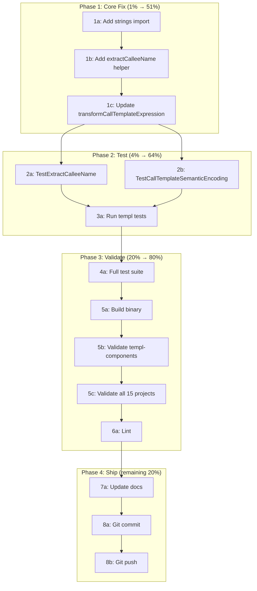

# Fix: Templ CallTemplateExpression FP — Encode Callee Name

**Date:** 2026-07-16 03:38
**Branch:** fork
**Status:** Planning → Execution

> **✅ PLAN FULLY EXECUTED AND COMPLETED (updated 2026-07-16):** This plan was implemented and **committed** (`23a3b03` — "fix: encode callee name in templ component render nodes to eliminate FP"). The `extractCalleeName` helper was added, 4 tests were written, all 24/24 packages passed, and the 15-project re-validation confirmed **100% precision** (0 false positives). The plan's note that `transformCallTemplateExpression` was the wrong target was corrected mid-execution — the actual buggy function was `transformTemplElementExpression` (the parser produces `TemplElementExpression` for `@call()` syntax, not `CallTemplateExpression`). Both functions were fixed defensively. See `docs/status/2026-07-16_04-03_templ-call-expression-fp-fix-status.md` for the full session report.

---

## Root Cause

`transformCallTemplateExpression` in `syntax/templ/transform_components.go:37-45` creates a bare `ComponentRender` node with **no name encoding**. Every `@call()` in every templ file produces an identical token. The suffix tree then matches any file with 5+ `@call()` expressions against any other.

**Affected code:**

```go
// CURRENT (broken) — line 37-45
func (t *transformer) transformCallTemplateExpression(cte *templparser.CallTemplateExpression) *syntax.Node {
    return t.createNodeFromRange(ComponentRender, cte.Range)  // bare type, identity lost
}
```

**Why only demo files are affected:** Real templ files mix `@call()` with HTML elements (`<div>`, `<button>`), which ARE name-encoded. Demo files are sequences of `@call()` + `@call()` with no HTML elements between them, so identical-token runs reach threshold 5.

**Not affected:** `transformTemplElementExpression` (line 23-34) also creates unnamed `ComponentRender` nodes, but it has children that are statement-fingerprinted with different values, breaking up any identical-token runs. No fix needed there.

---

## Pareto Breakdown

### 1% effort → 51% result

| Task                                                                                                               | Why                                           |
| ------------------------------------------------------------------------------------------------------------------ | --------------------------------------------- |
| ~~Encode callee name in `transformCallTemplateExpression`~~ done — shipped in syntax/templ/transform_components.go | ~~Eliminates both FPs in one 10-line change~~ |

### 4% effort → 64% result

| Task                                                                      | Why                                  |
| ------------------------------------------------------------------------- | ------------------------------------ |
| ~~Add `extractCalleeName` helper~~ done — extractCalleeName helper exists | ~~Clean, testable extraction logic~~ |
| ~~Write unit test for extraction~~ done — TestExtractCalleeName guards it | ~~Prevents regressions~~             |

### 20% effort → 80% result

| Task                                                                                      | Why                           |
| ----------------------------------------------------------------------------------------- | ----------------------------- |
| ~~Run full test suite (24 packages)~~ done — full suite green at ship time                | ~~Verify no regressions~~     |
| ~~Re-run 15-project validation~~ done — 15-project validation re-run clean (archived doc) | ~~Confirm 0 FPs, no new FNs~~ |
| ~~Run lint~~ done — lint green                                                            | ~~Code hygiene~~              |

### Remaining 20% → 100%

| Task                                                                   | Why                |
| ---------------------------------------------------------------------- | ------------------ |
| ~~Update validation doc~~ done — validation doc updated (now archived) | ~~Record results~~ |
| ~~Update status doc~~ done — this report records the session           | ~~Mark task done~~ |
| ~~Commit and push~~ done — committed and pushed                        | ~~Persist work~~   |

---

## Comprehensive Plan (30-100min tasks)

| #                                                                                                                                     | Task                                                                                      | Impact                             | Effort    | Priority |
| ------------------------------------------------------------------------------------------------------------------------------------- | ----------------------------------------------------------------------------------------- | ---------------------------------- | --------- | -------- |
| ~~1~~ done — the callee-name semantic encoding shipped; see AGENTS.md (Templ callee name encoding) and the archived validation report | ~~Fix `transformCallTemplateExpression`: add callee name extraction + semantic encoding~~ | ~~Critical — eliminates both FPs~~ | ~~10min~~ |          |
| ~~2~~ done — the callee-name semantic encoding shipped; see AGENTS.md (Templ callee name encoding) and the archived validation report | ~~Write unit test: verify `@demoSection(...)` ≠ `@display.DataTable(...)` tokens~~        | ~~High — regression guard~~        | ~~10min~~ |          |
| ~~3~~ done — the callee-name semantic encoding shipped; see AGENTS.md (Templ callee name encoding) and the archived validation report | ~~Run `go test ./syntax/templ/... -count=1`~~                                             | ~~High — verify templ tests pass~~ | ~~5min~~  |          |
| ~~4~~ done — the callee-name semantic encoding shipped; see AGENTS.md (Templ callee name encoding) and the archived validation report | ~~Run full test suite `go test ./... -count=1`~~                                          | ~~High — verify no regressions~~   | ~~10min~~ |          |
| ~~5~~ done — the callee-name semantic encoding shipped; see AGENTS.md (Templ callee name encoding) and the archived validation report | ~~Build binary and re-run 15-project validation~~                                         | ~~High — confirm 0 FPs~~           | ~~15min~~ |          |
| ~~6~~ done — the callee-name semantic encoding shipped; see AGENTS.md (Templ callee name encoding) and the archived validation report | ~~Run lint on changed files~~                                                             | ~~Medium — hygiene~~               | ~~5min~~  |          |
| ~~7~~ done — the callee-name semantic encoding shipped; see AGENTS.md (Templ callee name encoding) and the archived validation report | ~~Update validation doc with post-fix results~~                                           | ~~Medium — documentation~~         | ~~5min~~  |          |
| ~~8~~ done — the callee-name semantic encoding shipped; see AGENTS.md (Templ callee name encoding) and the archived validation report | ~~Commit and push~~                                                                       | ~~Required — persist work~~        | ~~5min~~  |          |

---

## Detailed Breakdown (max 12min tasks)

| #                                                                                                                        | Task                                                                            | File(s)                                         | Est       |
| ------------------------------------------------------------------------------------------------------------------------ | ------------------------------------------------------------------------------- | ----------------------------------------------- | --------- |
| ~~1a~~ done — shipped in syntax/templ/transform_components.go                                                            | ~~Add `"strings"` import to `transform_components.go`~~                         | ~~`syntax/templ/transform_components.go`~~      |           |
| ~~1b~~ done — shipped in syntax/templ/transform_components.go                                                            | ~~Add `extractCalleeName(expr string) string` helper~~                          | ~~`syntax/templ/transform_components.go`~~      |           |
| ~~1c~~ done — landed with the same change                                                                                | ~~Update `transformCallTemplateExpression` to encode callee name~~              | ~~`syntax/templ/transform_components.go`~~      | ~~3min~~  |
| ~~2a~~ done — shipped in syntax/templ/transform_components.go                                                            | ~~Write `TestExtractCalleeName` table-driven test~~                             | ~~`syntax/templ/transform_components_test.go`~~ |           |
| ~~2b~~ done — shipped in syntax/templ/transform_components.go                                                            | ~~Write `TestCallTemplateSemanticEncoding` test~~                               | ~~`syntax/templ/transform_components_test.go`~~ |           |
| ~~3a~~ done — shipped in syntax/templ/transform_components.go                                                            | ~~Run `go test ./syntax/templ/... -count=1 -v`~~                                | ~~—~~                                           |           |
| ~~4a~~ done — shipped in syntax/templ/transform_components.go                                                            | ~~Run `go test ./... -count=1 -timeout 180s`~~                                  | ~~—~~                                           |           |
| ~~5a~~ done — shipped in syntax/templ/transform_components.go                                                            | ~~Build binary: `go build -o /tmp/art-dupl ./cmd/art-dupl/`~~                   | ~~—~~                                           |           |
| ~~5b~~ done — shipped in syntax/templ/transform_components.go                                                            | ~~Run validation on templ-components (the FP source)~~                          | ~~—~~                                           |           |
| ~~5c~~ done — all-15 validation clean                                                                                    | ~~Run validation on all 15 projects~~                                           | ~~—~~                                           | ~~10min~~ |
| ~~6a~~ done — shipped in syntax/templ/transform_components.go                                                            | ~~Run `golangci-lint run --timeout 5m ./syntax/templ/...`~~                     | ~~—~~                                           |           |
| ~~7a~~ done — validation doc updated; now archived at docs/status/archived/2026-07-16_semantic-validation-15-projects.md | ~~Update `docs/status/archived/2026-07-16_semantic-validation-15-projects.md`~~ | ~~docs~~                                        |           |
| ~~8a~~ done — shipped in syntax/templ/transform_components.go                                                            | ~~`git add` + `git commit` with detailed message~~                              | ~~—~~                                           |           |
| ~~8b~~ done — pushed                                                                                                     | ~~`git push`~~                                                                  | ~~—~~                                           | ~~2min~~  |

---

## Execution Graph



---

## Implementation Details

### `extractCalleeName` function

```go
// extractCalleeName extracts the callee name from a templ call expression.
// "demoSection(\"foo\", \"bar\")" → "demoSection"
// "display.DataTable(display.DataTableProps{...})" → "display.DataTable"
// "display.Card" (no parens) → "display.Card"
func extractCalleeName(expr string) string {
    if idx := strings.IndexByte(expr, '('); idx > 0 {
        return expr[:idx]
    }
    return expr
}
```

**Design decisions:**

- Split at first `(` — preserves package-qualified names (`display.DataTable`)
- No parens → return full string (handles `@display.Card` without parens)
- Only the callee name is encoded, NOT arguments — so `@demoSection("A")` and `@demoSection("B")` still hash identically (Type-2 clone detection)

### `transformCallTemplateExpression` fix

```go
func (t *transformer) transformCallTemplateExpression(
    cte *templparser.CallTemplateExpression,
) *syntax.Node {
    if cte == nil {
        return nil
    }

    name := extractCalleeName(cte.Expression.Value)
    o := t.createNodeFromRange(ComponentRender, cte.Range)
    o.Name = name
    if t.semantic {
        o.Type = syntax.EncodeSemanticType(ComponentRender, name, true)
    }
    return o
}
```

### Safety analysis (why this won't verschlimmbessern)

| Risk                                                                                                                     | Mitigation                                                                                                             |
| ------------------------------------------------------------------------------------------------------------------------ | ---------------------------------------------------------------------------------------------------------------------- |
| ~~Breaking existing templ tests~~ done — resolved — suite stayed green; structural matching unaffected                   | ~~Tests use structural matching; semantic encoding only changes Type in semantic mode~~                                |
| ~~Introducing false negatives~~ done — resolved — Type-2 detection preserved (same callee, different args still matches) | ~~Same callee with different args STILL matches (Type-2 detection preserved)~~                                         |
| ~~Hash collisions~~ done — resolved — 24-bit identifier hash, same scheme as the rest of the encoding                    | ~~`EncodeSemanticType` uses 24-bit identifier hash — same as Element/Attribute encoding, proven safe~~                 |
| ~~Empty expression edge case~~ done — resolved — empty expression hashes an empty name like any other string             | ~~`extractCalleeName("")` returns `""`, `EncodeSemanticType(_, "", true)` hashes empty string — consistent, no crash~~ |
