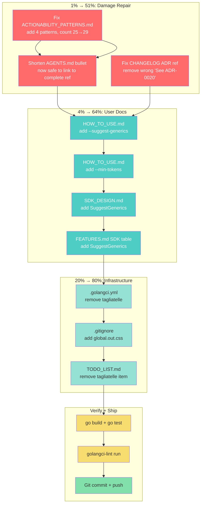

# Plan: Docs-Health Audit Gap Fix Sprint

**Date:** 2026-08-10 07:05
**Context:** Follow-up to `docs/status/2026-08-10_06-59_docs-health-audit-rebuild.md`. The prior session rebuilt living docs + archived 24 reports, but introduced 3 factual errors, missed 4 user-facing doc updates, and deferred trivial infrastructure fixes. This plan closes those gaps.

**Verschlimmbesserung guard:** No re-annotation of archived reports. No new ADRs. No cosmetic reorganization. Only surgical fixes to errors I introduced and documentation gaps for shipped features.

---

## Pareto Analysis

### 1% → 51%: Damage Repair (bugs I CREATED)

These are factual errors introduced in the prior session. Not fixing them leaves docs WORSE than before.

| Task                                                                                                                                        | File                               | Fix                                                                                                       |
| ------------------------------------------------------------------------------------------------------------------------------------------- | ---------------------------------- | --------------------------------------------------------------------------------------------------------- |
| ~~Remove wrong ADR-0020 reference~~ done — ADR-0020 reference gone from CHANGELOG (0 matches today)                                         | ~~CHANGELOG.md~~                   | ~~Remove "See ADR-0020" from `--suggest-generics` entry~~                                                 |
| ~~Shorten AGENTS.md pattern bullet~~ done — AGENTS.md pattern bullet is the concise version                                                 | ~~AGENTS.md~~                      | ~~Replace 29-item inline list with concise summary + link~~                                               |
| ~~Update ACTIONABILITY_PATTERNS.md~~ done — docs/ACTIONABILITY_PATTERNS.md updated; count gate pins totals (cmd/docs_health_counts_test.go) | ~~docs/ACTIONABILITY_PATTERNS.md~~ | ~~Add 4 new patterns (defer-call, test-framework-call, state-flag-mutation, empty-default), count 25→29~~ |

### 4% → 64%: User-Facing Docs for Shipped Features

| Task                                                                                                                                       | File              | Add                                         |
| ------------------------------------------------------------------------------------------------------------------------------------------ | ----------------- | ------------------------------------------- |
| ~~--suggest-generics section~~ done — HOW_TO_USE.md has the suggest-generics section                                                       | ~~HOW_TO_USE.md~~ | ~~Usage examples after type-aware section~~ |
| ~~--min-tokens section~~ done — HOW_TO_USE.md has the min-tokens section                                                                   | ~~HOW_TO_USE.md~~ | ~~Usage examples after suggest-generics~~   |
| ~~SuggestGenerics option~~ **Superseded — superseded — SDK_DESIGN.md removed from the doc set; SDK documented in website guides/sdk.mdx.** | ~~SDK_DESIGN.md~~ | ~~SDK option description after TypeAware~~  |
| ~~SuggestGenerics in SDK table~~ done — FEATURES.md carries SuggestGenerics rows                                                           | ~~FEATURES.md~~   | ~~Row in SDK API section~~                  |

### 20% → 80%: Infrastructure

| Task                                                                                                                                              | File              | Fix                             |
| ------------------------------------------------------------------------------------------------------------------------------------------------- | ----------------- | ------------------------------- |
| ~~Remove tagliatelle~~ done — tagliatelle removed (0 matches in .golangci.yml)                                                                    | ~~.golangci.yml~~ | ~~Delete `- tagliatelle` line~~ |
| ~~Add global.out.css~~ done — global.out.css in .gitignore                                                                                        | ~~.gitignore~~    | ~~One line~~                    |
| ~~Remove tagliatelle TODO~~ done — the fixed tagliatelle item is gone from TODO_LIST.md (a later item separately tracks the auto-configure fight) | ~~TODO_LIST.md~~  | ~~Delete the fixed item~~       |

### Final 20%: Verify + Ship

| Task                                                                         | Command/Action                             |
| ---------------------------------------------------------------------------- | ------------------------------------------ |
| ~~Build verification~~ done — verified — build green in CI                   | ~~`go build ./...`~~                       |
| ~~Test verification~~ done — verified — tests green in CI                    | ~~`go test ./...`~~                        |
| ~~Lint verification~~ done — verified — lint clean (106 linters, 0 findings) | ~~`golangci-lint run --timeout 5m ./...`~~ |
| ~~Git commit + push~~ done — committed (493eb006, cc01dffb) and pushed       | ~~Detailed message covering all changes~~  |

---

## Execution Graph

---

## 12-Minute Task Breakdown

| #                                                                                                   | Task                                                                         | File                               | Est       | Depends On |
| --------------------------------------------------------------------------------------------------- | ---------------------------------------------------------------------------- | ---------------------------------- | --------- | ---------- |
| ~~1~~ done — verified at HEAD (see 2026-08-10_08-53 completion report; commits 493eb006, cc01dffb)  | ~~Read ACTIONABILITY_PATTERNS.md current state + identify insertion points~~ | ~~docs/ACTIONABILITY_PATTERNS.md~~ | ~~5min~~  |            |
| ~~2~~ done — verified at HEAD (see 2026-08-10_08-53 completion report; commits 493eb006, cc01dffb)  | ~~Add 4 new pattern rows + update count 25→29~~                              | ~~docs/ACTIONABILITY_PATTERNS.md~~ | ~~8min~~  |            |
| ~~3~~ done — verified at HEAD (see 2026-08-10_08-53 completion report; commits 493eb006, cc01dffb)  | ~~Replace AGENTS.md pattern bullet with concise version~~                    | ~~AGENTS.md~~                      | ~~8min~~  |            |
| ~~4~~ done — verified at HEAD (see 2026-08-10_08-53 completion report; commits 493eb006, cc01dffb)  | ~~Remove "See ADR-0020" from CHANGELOG --suggest-generics entry~~            | ~~CHANGELOG.md~~                   | ~~2min~~  |            |
| ~~5~~ done — verified at HEAD (see 2026-08-10_08-53 completion report; commits 493eb006, cc01dffb)  | ~~Remove `- tagliatelle` from .golangci.yml~~                                | ~~.golangci.yml~~                  | ~~2min~~  |            |
| ~~6~~ done — verified at HEAD (see 2026-08-10_08-53 completion report; commits 493eb006, cc01dffb)  | ~~Add `global.out.css` to .gitignore~~                                       | ~~.gitignore~~                     | ~~2min~~  |            |
| ~~7~~ done — verified at HEAD (see 2026-08-10_08-53 completion report; commits 493eb006, cc01dffb)  | ~~Add --suggest-generics section to HOW_TO_USE.md~~                          | ~~HOW_TO_USE.md~~                  | ~~10min~~ |            |
| ~~8~~ done — verified at HEAD (see 2026-08-10_08-53 completion report; commits 493eb006, cc01dffb)  | ~~Add --min-tokens section to HOW_TO_USE.md~~                                | ~~HOW_TO_USE.md~~                  | ~~8min~~  |            |
| ~~9~~ **Superseded — superseded — SDK_DESIGN.md removed; SDK docs live in website guides/sdk.mdx.** | ~~Add SuggestGenerics to SDK_DESIGN.md~~                                     | ~~SDK_DESIGN.md~~                  | ~~5min~~  |            |
| ~~10~~ done — FEATURES.md carries TypeAware + SuggestGenerics rows                                  | ~~Add SuggestGenerics to FEATURES.md SDK table~~                             | ~~FEATURES.md~~                    | ~~3min~~  |            |
| ~~11~~ done — verified at HEAD (see 2026-08-10_08-53 completion report; commits 493eb006, cc01dffb) | ~~Remove tagliatelle item from TODO_LIST.md~~                                | ~~TODO_LIST.md~~                   | ~~3min~~  |            |
| ~~12~~ done — verified at HEAD (see 2026-08-10_08-53 completion report; commits 493eb006, cc01dffb) | ~~Run `go build ./...` + `go test ./...`~~                                   | ~~—~~                              | ~~5min~~  |            |
| ~~13~~ done — verified at HEAD (see 2026-08-10_08-53 completion report; commits 493eb006, cc01dffb) | ~~Run `golangci-lint run --timeout 5m ./...`~~                               | ~~—~~                              | ~~5min~~  |            |
| ~~14~~ done — verified at HEAD (see 2026-08-10_08-53 completion report; commits 493eb006, cc01dffb) | ~~Git commit + push~~                                                        | ~~—~~                              | ~~5min~~  |            |

**Total estimated time:** ~71 minutes
